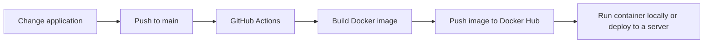

<div align="center">

# FastAPI CI/CD

### A small FastAPI service, packaged with Docker and published automatically with GitHub Actions.

[](https://github.com/krishnegowda9/Fastapi_CI-CD/actions/workflows/docker-build-push.yml)
[](https://www.python.org/)
[](https://fastapi.tiangolo.com/)
[](https://www.docker.com/)

**Develop locally · Build a container · Publish on every push to `main`**

</div>

---

## Overview

This project is a learning-friendly example of a CI/CD pipeline for a Python API. The FastAPI service exposes a welcome endpoint, a list endpoint, and a health check. A GitHub Actions workflow builds the Docker image and pushes it to Docker Hub whenever code is pushed to `main`.



> **What this pipeline does:** builds and publishes the container image. It does not deploy the app to a public hosting service.

## API

| Method | Endpoint | Description |
|:--|:--|:--|
| `GET` | `/` | Welcome message and API version |
| `GET` | `/students` | Returns the configured names list |
| `GET` | `/health` | Basic health status |
| `GET` | `/docs` | Interactive Swagger UI |
| `GET` | `/redoc` | ReDoc API reference |

Example health response:

```json
{
  "status": "running"
}
```

## Run locally with Python

You need Python 3.11 or later. From the project directory, run:

```powershell
py -m venv .venv
.\.venv\Scripts\Activate.ps1
python -m pip install -r requirements.txt
python -m uvicorn app.main:app --reload
```

If PowerShell does not recognize `py`, use `python` instead. When the server starts, visit:

- API: <http://127.0.0.1:8000>
- Interactive docs: <http://127.0.0.1:8000/docs>
- Health check: <http://127.0.0.1:8000/health>

Stop the development server with **Ctrl+C**.

## Run with Docker

Install and start Docker Desktop first. From the project directory, build and run the image:

```powershell
docker build -t student-fastapi:local .
docker run --rm -p 8000:8000 student-fastapi:local
```

Open <http://localhost:8000/docs>. Stop the container with **Ctrl+C**.

### Run the published image

The workflow publishes the image as `<DOCKER_USERNAME>/student-fastapi:latest`, where `DOCKER_USERNAME` is your Docker Hub username. After the workflow succeeds, pull and run it with:

```powershell
docker pull <DOCKER_USERNAME>/student-fastapi:latest
docker run --rm -p 8000:8000 <DOCKER_USERNAME>/student-fastapi:latest
```

Replace `<DOCKER_USERNAME>` with your actual Docker Hub username (do not include the angle brackets).

## CI/CD setup

The workflow is at [`.github/workflows/docker-build-push.yml`](.github/workflows/docker-build-push.yml). It runs on pushes to the `main` branch and:

1. Checks out the repository.
2. Signs in to Docker Hub using GitHub Actions secrets.
3. Builds the image from the `Dockerfile`.
4. Pushes the image to Docker Hub as `student-fastapi:latest`.

### Add the required GitHub Actions secrets

In the GitHub repository, open **Settings → Secrets and variables → Actions → New repository secret** and add:

| Secret name | Value |
|:--|:--|
| `DOCKER_USERNAME` | Your Docker Hub username |
| `DOCKER_PASSWORD` | A Docker Hub access token with read/write permission |

Use a Docker Hub access token, not your account password. Keep both values private; never add them to source files.

### Trigger a build

Commit and push a change to `main`:

```powershell
git add .
git commit -m "Describe your change"
git push origin main
```

Follow the result in the repository’s **Actions** tab. A successful run means the image was built and pushed; it does not mean the app was deployed online.

## Project structure

```text
.
├── app/
│   └── main.py                       # FastAPI routes
├── .github/
│   └── workflows/
│       └── docker-build-push.yml     # Build-and-publish workflow
├── Dockerfile                        # Container image instructions
├── docker-compose.yaml               # Compose configuration
├── requirements.txt                  # Python dependencies
└── .dockerignore                     # Files excluded from Docker builds
```

## Notes

- The Compose file currently references `krishnegowda2005/student-fastapi:latest`. If your `DOCKER_USERNAME` secret has a different value, change the Compose image to `<your-Docker-Hub-username>/student-fastapi:latest` before using `docker compose up`.
- Port `8000` must be free on your computer. If it is already in use, stop the other service or map another host port, for example `-p 8001:8000`, then visit <http://localhost:8001>.

---

<div align="center">

Built as a hands-on introduction to **FastAPI · Docker · GitHub Actions · CI/CD**

</div>
